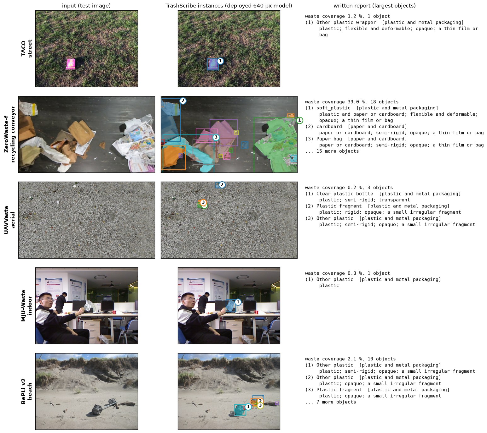
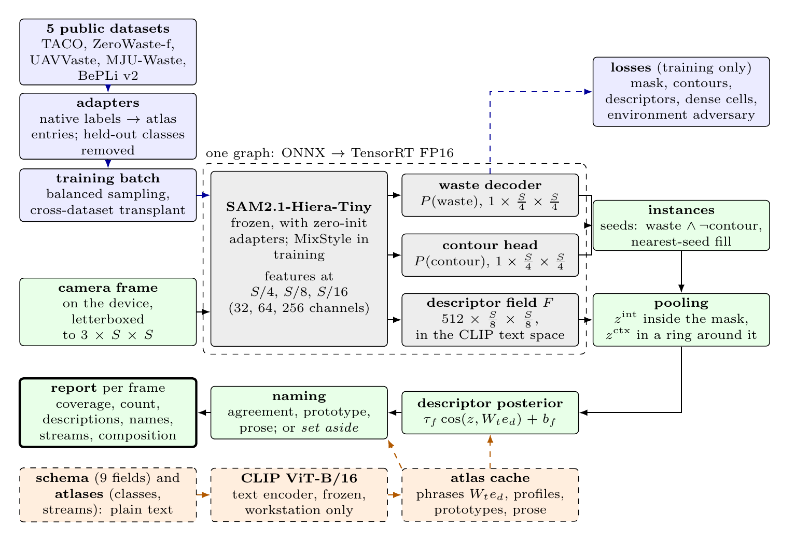
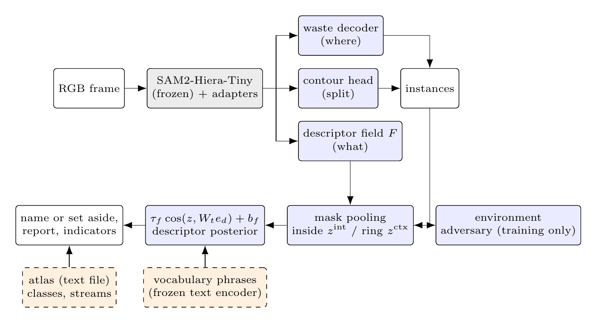
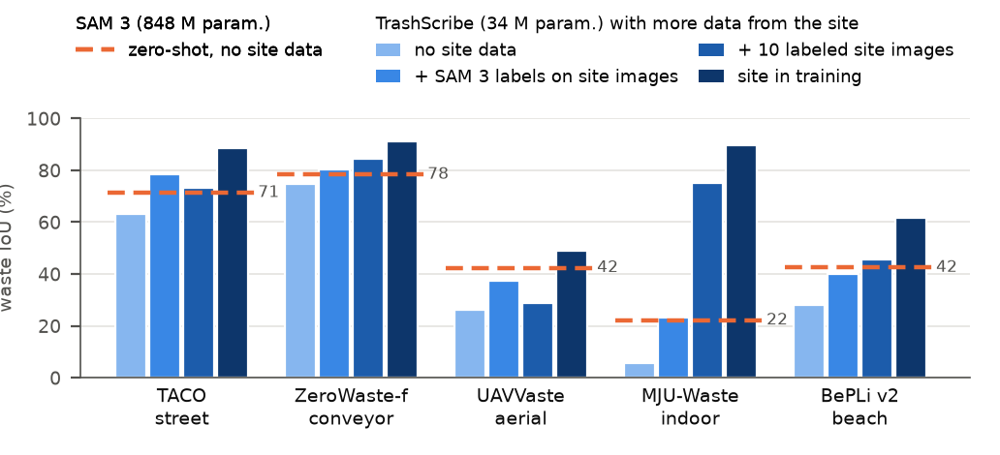
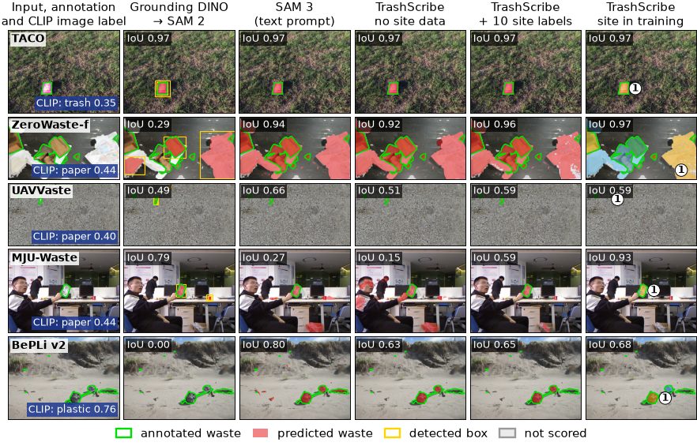
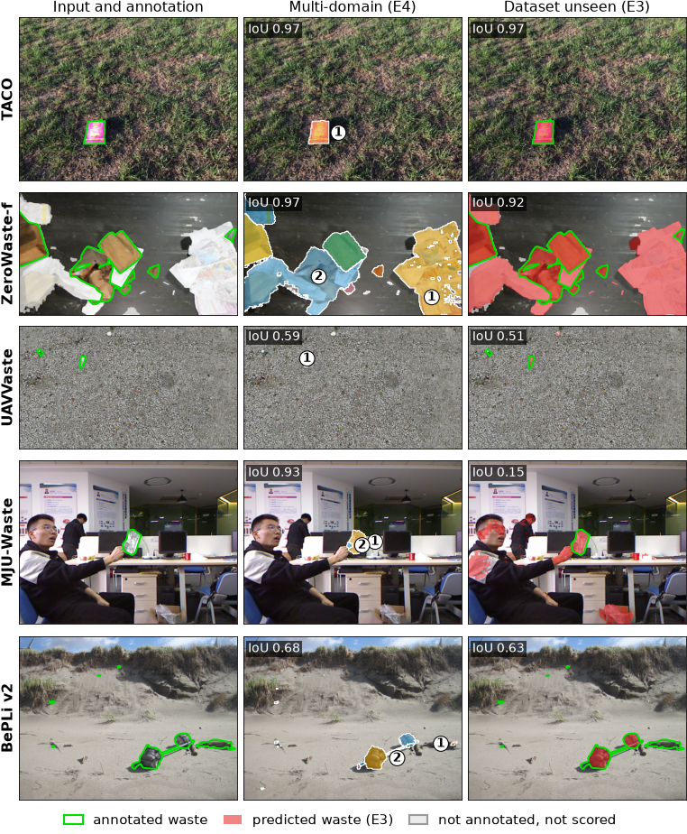

<div align="center">

# TrashScribe

### Segmenting and describing waste across environments on an edge device

[](environment.yml)
[](environment.yml)
[](#9-deploy-on-a-jetson-orin-nano)
[](LICENSE)
[](#citation)

</div>

<p align="center">
  
</p>
<p align="center"><sub>
The deployed 640 px model on one test image of each environment (images drawn by a fixed rule, not chosen by result).
Every object gets a mask, a description in a controlled vocabulary, a name read from a text atlas and a collection stream.
</sub></p>

TrashScribe is a **34 M-parameter network** that finds waste in an image, splits it into objects and
**describes every object** by nine visual properties (material, rigidity, optics, shape, surface, color, state,
size, surroundings) in **one forward pass**. Class names and collection streams are not network outputs: they
are written in a plain-text **atlas** and read at inference, so a new class or a different municipal sorting
rule is a text edit, not a retraining. The deployed model runs offline on a **Jetson Orin Nano 8 GB at 8 to 10
frames per second** (15 W).

The system was built for a remotely guided wheeled rover that carries a Jetson Orin Nano and a camera over
beaches and natural habitats. On every frame it reports how much waste there is, where it lies and what it is
made of.

## Contents

- [Highlights](#highlights)
- [Abstract](#abstract)
- [Method](#method)
- [Results](#results)
- [Repository layout](#repository-layout)
- [Tutorial](#tutorial)
- [Pretrained model](#pretrained-model)
- [Limitations](#limitations)
- [Citation](#citation)
- [License and acknowledgments](#license-and-acknowledgments)

## Highlights

- **One small network, three answers.** Where the waste is (prompt-free mask), how it splits into objects
  (contours) and what each object looks like (a dense descriptor field in the CLIP text space).
- **A cross-environment benchmark.** Five public datasets (street, recycling conveyor, aerial, indoor, beach)
  mapped to one waste mask and one attribute vocabulary, each tested as an environment never seen in training.
- **Against SAM 3 (848 M parameters).** With the site in training TrashScribe is ahead on all five
  environments (waste IoU 49 to 91 against 22 to 78). On a site never seen SAM 3 is ahead on all five.
  Ten labeled site images or SAM 3's own labels on unlabeled site images bring TrashScribe to or above SAM 3
  on four of five (aerial litter is the exception); indoors, 243 generic photographs without waste are enough
  (IoU 5.5 to 36.3).
- **Description at three times chance.** Macro mAP 0.691 over eight intrinsic properties, against a
  prevalence floor of 0.226 and 0.305 for CLIP on object crops.
- **Classes as text.** Unseen classes, including one that exists only as a sentence in the atlas (fishing
  net), are retrieved well above chance; an optional head distilled from CLIP reads new classes and
  properties like CLIP, inside the same pass.
- **Edge.** TensorRT FP16 network in 47.9 ms, full pipeline in 97 to 126 ms, 0.5 GB, 13.8 W. SAM 3 compiled
  with TensorRT on the same board needs 3.2 s per frame: TrashScribe is 25 to 33 times faster.
- **Honest baseline.** A fully fine-tuned SegFormer-B2 transfers to new environments as well as TrashScribe
  or better. The frozen encoder buys efficiency and one shared representation, not transfer.

## Abstract

> Monitoring waste needs vision systems that work in many environments, run on low-power devices and report
> what each object is made of. Waste segmentation models are tested on one dataset at a time; foundation models
> such as SAM 3 transfer across environments but are too slow for embedded hardware and return names, not
> properties. We present TrashScribe, a 34 M-parameter network that segments waste and describes every object by
> nine visual properties, such as material and rigidity, in one pass. A frozen SAM 2 encoder with
> zero-initialized adapters feeds a prompt-free waste decoder and a dense descriptor field scored against text.
> A new benchmark unifies five public datasets (street, recycling conveyor, aerial, indoor, beach) and tests each
> environment left out of training. Trained on all five, TrashScribe beats the 848 M-parameter SAM 3 everywhere
> (waste IoU 49 to 91 against 22 to 78) and describes objects at three times the chance level (macro mAP 0.69
> against 0.23). On an unseen environment SAM 3 leads on all five, but ten labeled site images or SAM 3's labels
> on unlabeled ones bring TrashScribe to or above it on four of five, aerial litter excepted; indoors, 243
> photographs without waste suffice. A fully fine-tuned SegFormer-B2 transfers as well or better. A head
> distilled from CLIP retrieves unseen classes as well as CLIP on object crops. On a Jetson Orin Nano at 15 W the
> complete system processes 8 to 10 frames per second; SAM 3 needs 3.2 s per frame even with TensorRT.

## Method

### Data flow

<p align="center"></p>

The system has three paths. **Training** (blue) converts every dataset to one sample format, mixes datasets
and environments in each batch and supervises the three output maps. **Text** (orange, dashed) runs once on a
workstation: the vocabulary and the atlases are plain YAML files, encoded by the frozen CLIP text encoder into
an *atlas cache* of a few hundred vectors. **Deployment** (green) runs on the device for every frame: one
network call (gray, a single TensorRT engine) gives the waste probability, the contour probability and the
descriptor field; everything downstream is a handful of matrix products against the cache. The text encoder
never runs on the device. $S$ is the input size (1024 px in the experiments, 640 px for the deployed model).

### Network

<p align="center"></p>

- **Encoder.** SAM2.1-Hiera-Tiny, frozen, with a zero-initialized bottleneck adapter after the attention of
  each of its 12 blocks, so training starts exactly from the pre-trained model.
- **Waste decoder (where).** The SAM 2 mask decoder trained without any prompt: it predicts the waste
  probability at stride 4. Every dataset annotates this mask, so the decoder is shared by all of them.
- **Contour head (split).** Predicts object boundaries; connected components of waste away from contours
  seed the instances, every other waste pixel joins its nearest seed. The cost does not grow with the number
  of objects.
- **Descriptor field (what).** A 512-d vector per pixel at stride 8 in the frozen CLIP ViT-B/16 text space.
  Each object is pooled inside its mask ($z^{\mathrm{int}}$) and on a ring around it ($z^{\mathrm{ctx}}$),
  then scored against every vocabulary phrase $e_d$:
  $s(z,d) = \tau_{f}\cos(z, W_t e_d) + b_{f}$.
  Only the two scalars $\tau_f, b_f$ of each field are field-specific (18 in total): no parameter belongs to a
  descriptor value or a class, so a new phrase is scored through the same computation.
- **Environment adversary** (training only) and cross-dataset object transplant, against the background
  shortcut (cardboard on the conveyor, fragments on the sand).

33.78 M parameters in total, 6.56 M trained.

### Vocabulary and atlas

The vocabulary ([atlas/schema.yaml](atlas/schema.yaml)) has nine fields with 59 values. Intrinsic fields are
read inside the object; the contextual field *surroundings* is read on the ring around it and never used to
name an object.

| Field | Kind | Values | Naming weight | Examples of values |
|---|---|:-:|:-:|---|
| material | multi | 11 | 1.0 | plastic; paper or cardboard; metal; glass; expanded polystyrene foam |
| rigidity | single | 3 | 0.8 | rigid; semi-rigid; flexible and deformable |
| optics | single | 3 | 0.8 | transparent; translucent; opaque |
| shape | single | 11 | 1.0 | bottle-shaped; a thin film or bag; a small lid or cap; string-like |
| surface | multi | 6 | 0.5 | glossy; metallic and reflective; crumpled or wrinkled |
| color | multi | 10 | 0.3 | white; brown or beige; colorless; multicolored |
| state | single | 3 | 0.4 | intact; crushed or dented; torn or broken into pieces |
| size | single | 4 | 0.4 | tiny, smaller than a finger; hand-sized; bulky |
| surroundings | single | 8 | 0.0 | sand, soil or pebbles; pavement or road; a conveyor belt |

An **atlas** describes classes in that vocabulary. Atlases are provided for the 60 TACO classes, the four
ZeroWaste classes, the BePLi v2 classes and a *novel* atlas of classes that no training set labels (fishing
net, disposable face mask, disposable vape, tire). This entry is all the system knows about fishing nets:

```yaml
- name: Fishing net
  descriptors: {material: [plastic, textile or fabric], rigidity: flexible and deformable, optics: translucent,
                shape: string-like or rope-like, surface: [dirty or weathered], size: bulky}
  prose: "a tangled piece of synthetic fishing net"
  stream: residual
```

Names are read from three streams of evidence (agreement of the description with the entry, a text prototype
of the entry, its prose sentence), with a penalty on trained classes and abstention (*set aside*) when no entry
explains the object.

## Results

All numbers come from the manuscript. Runs are single-seed: differences below about 3 mAP points, or 0.1 in
$H$, are within run-to-run variation.

<details>
<summary><b>Datasets and protocols</b></summary>

| Dataset | Environment | Annotation | Train / val / test | Classes |
|---|---|---|:-:|:-:|
| [TACO](https://github.com/pedropro/TACO) | street and outdoor | polygons | 1050 / 150 / 300 | 60 |
| [ZeroWaste-f](http://ai.bu.edu/zerowaste/) | recycling conveyor | polygons | 3002 / 572 / 929 | 4 |
| [UAVVaste](https://github.com/PUTvision/UAVVaste) | aerial, low altitude | polygons | 540 / 116 / 116 | 1 |
| [MJU-Waste](https://github.com/realwecan/mju-waste) | indoor, hand-held | binary masks | 1485 / 248 / 742 | 1 |
| [BePLi v2](https://www.seanoe.org/data/00858/96963/) | beach | RLE masks | 2234 / 744 / 744 | 13 |

| ID | Training data | Question | Config |
|---|---|---|---|
| E1 | one dataset | in-domain reference | `e1_indomain_<site>.yaml` |
| E3 | four datasets, the fifth left out (LODO) | transfer to an environment never seen | `e3_lodo_<site>.yaml` |
| E3b | E3 + 243 indoor photographs without waste | do generic negatives fix the indoor failure? | `e3b_lodo_mju_negatives.yaml` |
| E4 | five datasets, 7 classes held out | main model: seen environments, unseen classes | `e4_heldout_classes.yaml` |
| E5 | variants of E4 | ablations | `e5_ablate_*.yaml` |
| E6 | E4 at 640 px | the deployed model | `e6_edge_640.yaml` |
| E7 | E4 with 3 descriptor values never supervised | does the head read unsupervised properties? | `e7_heldout_values.yaml` |
| E8 | E7 + head distilled from CLIP | can one pass read new properties like CLIP? | `e8_clip_distill.yaml` |
| E9 | E3 fine-tuned with SAM 3 labels of unlabeled site images | SAM 3 as an offline teacher | `e9_sam3_<site>.yaml` |
| E10 | E3 fine-tuned with 10 (50) labeled site images | how few labels are enough? | `e10_k10_<site>.yaml` |

`<site>` is one of `taco`, `zerowaste`, `uavvaste`, `mju`, `bepli`; all configs are in [configs/exp/](configs/exp/).
The seven held-out TACO classes are Glass bottle, Pop tab, Plastic straw, Crisp packet, Paper bag, Foam cup and
Egg carton.

</details>

### Segmentation across environments

Waste IoU (%) on the test split of each dataset. In the LODO columns the dataset is never used for training or
model selection. E4 and E1 saw the dataset: they show what training on the environment gives, they are not
competitors.

| Dataset | OWLv2 + SAM 2.1 | G. DINO + SAM 2.1 | SAM 3 | SegFormer-B2 LODO | **TrashScribe LODO** | TrashScribe all five (E4) | TrashScribe in-domain (E1) |
|---|:-:|:-:|:-:|:-:|:-:|:-:|:-:|
| TACO | 12.1 | 51.0 | 71.3 | 74.6 | 63.0 | 88.5 | 86.2 |
| ZeroWaste-f | 24.3 | 27.3 | 78.3 | 74.1 | 74.7 | 91.2 | 92.2 |
| UAVVaste | 1.9 | 18.3 | 42.4 | 48.0 | 26.2 | 49.0 | 61.6 |
| MJU-Waste | 12.5 | 15.4 | 22.1 | 10.4 | 5.5 | 89.5 | 91.4 |
| BePLi v2 | 13.7 | 18.0 | 42.4 | 27.6 | 28.2 | 61.6 | 65.0 |

Zero-shot baselines use six (detectors) or sixteen (SAM 3) waste phrases; boxes or instances larger than half
the image are dropped.

### Edge model against SAM 3 as site data grows

<p align="center"></p>

| Site | SAM 3 | LODO | + negatives (E3b) | + SAM 3 labels (E9) | + 10 labels (E10) | + 50 labels (E10) | site seen (E4) |
|---|:-:|:-:|:-:|:-:|:-:|:-:|:-:|
| TACO | 71.3 | 63.0 | n/r | **78.3** | **73.3** | n/r | **88.5** |
| ZeroWaste-f | 78.3 | 74.7 | n/r | **80.5** | **84.3** | n/r | **91.2** |
| UAVVaste | 42.4 | 26.2 | n/r | 37.5 | 28.9 | 29.4 | **49.0** |
| MJU-Waste | 22.1 | 5.5 | **36.3** | **23.1** | **75.1** | n/r | **89.5** |
| BePLi v2 | 42.4 | 28.2 | n/r | 39.8 | **45.4** | n/r | **61.6** |

Waste IoU (%). SAM 3 uses no site data. **Bold**: at or above SAM 3. n/r: not run. The negatives are 243
generic indoor COCO photographs with people and no waste, none from MJU-Waste. SAM 3 is scored with the same
half-image rule as the detectors; without it SAM 3 scores higher on TACO (75.9) and ZeroWaste-f (79.3) but
lower on BePLi v2 (27.2), so on TACO ten labeled images (73.3) would stay below it.

### Description and open vocabulary

Descriptor prediction on the 27,853 test objects of E4, mean average precision per field. *Floor*: prevalence,
the AP of a random ranking. *CLIP*: CLIP ViT-B/16 on object crops against the same phrases. *Probe*:
closed-vocabulary linear head with one weight vector per value.

| Field | Floor | CLIP | Probe | **TrashScribe** |
|---|:-:|:-:|:-:|:-:|
| material | 0.114 | 0.204 | 0.466 | 0.442 |
| rigidity | 0.333 | 0.420 | 0.833 | 0.833 |
| optics | 0.333 | 0.374 | 0.716 | 0.720 |
| shape | 0.091 | 0.251 | 0.505 | 0.496 |
| surface | 0.179 | 0.161 | 0.687 | 0.677 |
| color | 0.170 | 0.298 | 0.816 | 0.738 |
| state | 0.333 | 0.369 | 0.924 | 0.875 |
| size | 0.250 | 0.359 | 0.748 | 0.744 |
| surroundings | 0.125 | 0.215 | 0.814 | 0.823 |
| **macro (intrinsic)** | 0.226 | 0.305 | 0.712 | **0.691** |

The text-space head describes as well as a closed head on supervised values, but it does not read values that
were never supervised (E7). The head distilled from CLIP (E8) restores that reading inside the same pass.

<details>
<summary><b>Retrieval of unseen classes from their atlas entry alone</b></summary>

Six held-out TACO classes (no image of them reached training or validation) plus the text-only fishing net of
BePLi v2, retrieved among all 27,853 test objects of E4. Lift: AP over prevalence; $p$: 2,000 permutations;
95% bootstrap interval.

| Class | $n$ | AP | 95% CI | Lift | $p$ |
|---|:-:|:-:|:-:|:-:|:-:|
| Crisp packet | 8 | 0.013 | [0.00, 0.08] | 45.3 | 0.003 |
| Fishing net | 319 | 0.094 | [0.08, 0.12] | 8.2 | <0.001 |
| Foam cup | 5 | 0.089 | [0.00, 0.45] | 494.7 | 0.002 |
| Glass bottle | 19 | 0.009 | [0.00, 0.04] | 13.4 | 0.009 |
| Paper bag | 5 | 0.001 | [0.00, 0.00] | 3.4 | 0.119 |
| Plastic straw | 26 | 0.011 | [0.00, 0.03] | 12.0 | 0.002 |
| Pop tab | 10 | 0.019 | [0.00, 0.17] | 53.2 | 0.003 |

CLIP on crops retrieves the same classes better (mean AP 0.078 against 0.034); so does the distilled head, in
the single pass (0.082, all seven with $p<0.01$). Naming unseen classes among all 74 atlas entries remains
harder than for CLIP on crops ($H$ 12.0 for the distilled head against 22.4).

</details>

<details>
<summary><b>Ablations</b></summary>

Ablations on E4 (%). IoU: pooled waste IoU over the five test sets. Desc. mAP: macro mAP of the intrinsic
fields. Seen, Unseen, $H$: naming at the validation-calibrated operating point. Env. probe: accuracy of a
linear probe recovering the surroundings from the intrinsic object embedding (lower is better; majority rate
74.8). n/a: the variant cannot produce the quantity.

| Variant | IoU | Desc. mAP | Seen | Unseen | $H$ | Env. probe |
|---|:-:|:-:|:-:|:-:|:-:|:-:|
| Full TrashScribe (E4) | 87.0 | 69.1 | 18.2 | 2.9 | 4.9 | 98.5 |
| without object transplant | 86.8 | 66.1 | 15.7 | 3.6 | 5.8 | 98.4 |
| without environment adversary | 87.0 | 69.9 | 16.1 | 5.7 | 8.4 | 99.2 |
| without MixStyle | 87.2 | 69.1 | 16.6 | 2.9 | 4.9 | 98.2 |
| without all three | 87.4 | 69.4 | 17.4 | 1.8 | 3.2 | 99.0 |
| without dense pixel loss | 87.0 | 64.9 | 14.5 | 4.6 | 7.0 | 98.9 |
| closed-vocabulary probe head | 86.9 | 71.2 | n/a | n/a | n/a | 97.8 |
| no description (segmentation only) | 87.7 | n/a | n/a | n/a | n/a | 97.4 |
| Full, 640 px (deployed model, E6) | 85.6 | 63.2 | 14.4 | 5.7 | 8.2 | 98.3 |

The pooled probe is high because in these datasets the class predicts the place. Restricted to objects of the
same class found in different environments, the intrinsic embedding predicts the environment only 6.9 points
above the majority rate, against 20.7 for the contextual embedding.

</details>

### On-device performance

Jetson Orin Nano 8 GB, JetPack 6.2, TensorRT 10.3, 15 W mode, clocks locked. Milliseconds per frame, frames per
second in brackets. *Network*: the TrashScribe engine alone, or for SAM 3 the image encoder plus one decoder pass
for each of its sixteen prompts. *Full pipeline*: pre-processing, network and post-processing in Python on 30
real test images per dataset.

| Model | Runtime | Network | TACO | UAVVaste | ZeroWaste-f | Memory (GB) | Power (W) |
|---|---|:-:|:-:|:-:|:-:|:-:|:-:|
| **TrashScribe** | TensorRT FP16 | **47.9 (20.8)** | **104 (9.7)** | **97 (10.3)** | **126 (8.0)** | **0.5** | 13.8 |
| TrashScribe | TensorRT FP32 | 96.7 (10.3) | 151 (6.6) | 146 (6.9) | 170 (5.9) | 0.6 | 14.6 |
| TrashScribe | PyTorch FP16 | 93.4 (10.7) | 148 (6.8) | 145 (6.9) | 173 (5.8) | 1.1 | n/m |
| SAM 3 | TensorRT FP16 | 3,110 (0.32) | 3,146 (0.32) | 3,155 (0.32) | 3,167 (0.32) | 1.6 | 14.1 |
| SAM 3 | PyTorch BF16 | 5,141 (0.19) | 5,181 (0.19) | 5,176 (0.19) | 5,191 (0.19) | 3.2 | 12.7 |

n/m: not measured. TrashScribe finds 4.3, 2.4 and 13.6 objects per frame on the three datasets. The FP16 engine
gives the same waste masks as ONNX Runtime FP32 (IoU 0.997 or more); the SAM 3 FP16 engines agree with PyTorch
BF16 at IoU 0.991. The network costs 0.72 J per frame (idle 5.8 W).

### Qualitative comparison

<p align="center"></p>

One test image per dataset, drawn by a fixed rule. Green outline: annotated waste; red: predicted waste; yellow:
detector boxes; washed-out pixels are not annotated and not scored. The numbered object of each image is
described below as material; rigidity; optics; shape.

| Dataset | Annotated class | Annotation profile | CLIP on the crop | TrashScribe (E4): name and description |
|---|---|---|---|---|
| TACO | Crisp packet (held out) | plastic & metal; flexible and deformable; opaque; a thin film or bag | food or organic matter; semi-rigid; opaque; a thin film or bag | **Other plastic wrapper**: plastic; flexible and deformable; opaque; a thin film or bag |
| ZeroWaste-f | soft plastic | plastic; flexible and deformable; a thin film or bag | paper or cardboard; semi-rigid; opaque; bottle-shaped | **soft plastic**: plastic; flexible and deformable; opaque; a thin film or bag |
| UAVVaste | waste | n/a (single class) | cigarette filter material; semi-rigid; transparent; bottle-shaped | **Clear plastic bottle**: plastic; semi-rigid; transparent; bottle-shaped |
| MJU-Waste | waste | n/a (single class) | cigarette filter material; semi-rigid; transparent; a thin film or bag | **Plastic fragment**: plastic; rigid; opaque; a thin film or bag |
| BePLi v2 | Styrofoam piece | expanded polystyrene foam; semi-rigid; opaque; a small irregular fragment | rubber; flexible and deformable; opaque; string-like or rope-like | **Other plastic**: plastic; semi-rigid; opaque; a small irregular fragment |

The description can be right where the name is wrong: the held-out crisp packet is read as a flexible, opaque
plastic film and named after the closest trained class.

<details>
<summary><b>More qualitative results: all five datasets in training (E4) against the dataset left out (E3)</b></summary>

<p align="center"></p>

</details>

## Repository layout

```
TrashScribe/
├── trashscribe/            Python package
│   ├── models/             frozen SAM 2.1 backbone with adapters, heads, full model, export graph
│   ├── data/               dataset adapters, canonical sample, mixing and transplant, registry
│   ├── engine.py           configs, training loop, evaluation, loading a run
│   ├── naming.py           atlas cache, naming with abstention
│   ├── monitoring.py       per-frame report (coverage, objects, composition)
│   └── edge_runtime.py     TensorRT, ONNX Runtime or PyTorch backend and the edge pipeline
├── atlas/                  schema.yaml (vocabulary) and the atlases (taco, zerowaste, bepli, binary, novel)
├── configs/                base.yaml, datasets.yaml (dataset registry), exp/ (one file per run), gpu_queue.yaml
├── scripts/                training, evaluation, baselines, export, Jetson tools, tables and figures
├── tests/                  unit tests of the design properties
├── docs/                   architecture, experiments, operations and Jetson notes
├── weights/e6_edge_640/    released checkpoint of the deployed model
├── assets/                 images of this README
├── RESULTS.md              experiment journal and generated result tables
├── attempts/ATTEMPTS.md    every change with its hypothesis and decision
└── runs/                   one folder per run (created by training, git-ignored)
```

## Tutorial

### 1. Install

Tested on Ubuntu with one NVIDIA GeForce RTX 3080 Laptop GPU (8 GB). The conda environment pins the exact
versions used for every run of the paper. From the root of this repository:

```bash
conda env create -f environment.yml        # Python 3.12.3, torch 2.9.1+cu130, transformers 5.2.0
conda activate trashscribe
python -m pytest tests -q                  # 14 tests
```

For another CUDA driver, replace `cu130` in [environment.yml](environment.yml). Without conda, install PyTorch
for your driver from [pytorch.org](https://pytorch.org) first, then `pip install -r requirements.txt`.

Models are downloaded from Hugging Face on first use: `facebook/sam2.1-hiera-tiny` (backbone, 149 MB) and
`openai/clip-vit-base-patch16` (text encoder). The baselines also need `facebook/sam3` (gated: accept its
license on Hugging Face, then `hf auth login`), `google/owlv2-base-patch16`, `IDEA-Research/grounding-dino-tiny`
and `nvidia/mit-b2`. Once they are cached, `export HF_HUB_OFFLINE=1` keeps every run offline.

### 2. Get the data

Download the five datasets from their sources and place them under one data root (default `~/data/waste`,
set by `data_root` in [configs/base.yaml](configs/base.yaml)):

| Dataset | Source | Version |
|---|---|---|
| TACO | [github.com/pedropro/TACO](https://github.com/pedropro/TACO) (Zenodo 3587843) | v1.0 |
| ZeroWaste-f | [ai.bu.edu/zerowaste](http://ai.bu.edu/zerowaste/) (Zenodo 6412647) | v1.2.1 |
| UAVVaste | [github.com/PUTvision/UAVVaste](https://github.com/PUTvision/UAVVaste) (Zenodo 8214061) | |
| MJU-Waste | [github.com/realwecan/mju-waste](https://github.com/realwecan/mju-waste) | v1.0 |
| BePLi v2 | [SEANOE 00858/96963](https://www.seanoe.org/data/00858/96963/) | v2 |
| COCO val2017 (E3b only) | [cocodataset.org](https://cocodataset.org/#download) | 2017 |

The registry [configs/datasets.yaml](configs/datasets.yaml) expects this layout:

```
~/data/waste/
├── TACO/data/                      batch_*/ images + annotations.json
├── zerowaste-f/{train,val,test}/   images + labels.json + belt/ (step c)
├── UAVVaste/                       images + annotations_{train,val,test}.json (step d)
├── MJU-Waste/                      JPEGImages/, SegmentationClass/, ImageSets/
├── BePLi_v2/{train,val,test}/      images + annotations.json
├── coco_neg/                       E3b negatives (step e)
└── _pseudo/sam3/<site>/            E9 SAM 3 labels (step 6)
```

```bash
# a) shrink COCO-style datasets to longest side <= 1024 px (the model input size); annotations are rescaled
python scripts/prepare_coco.py --src TACO.zip --ann TACO/data/annotations.json \
    --img-root TACO/data --out ~/data/waste/TACO/data

# b) list the native categories and those the atlas does not cover
python scripts/inspect_dataset.py ~/data/waste/TACO/data/annotations.json --atlas atlas/taco.yaml

# c) ZeroWaste-f leaves paper unlabeled: only the conveyor belt is a sure negative
for s in train val test; do python scripts/make_belt_masks.py ~/data/waste/zerowaste-f/$s; done

# d) UAVVaste: split annotations.json into annotations_{train,val,test}.json with the official
#    list in the archive (annotations/train_val_test_distribution_file.json)

# e) only for E3b: 243 indoor COCO scenes with people and no waste-like category
python scripts/make_negatives.py --zip-img ~/data/waste/_dl/coco/val2017.zip \
    --zip-ann ~/data/waste/_dl/coco/annotations_trainval2017.zip --out ~/data/waste/coco_neg
```

TACO has no official split: a fixed 70/10/20 split by image (seed 42) is drawn by the registry. If the data
lives elsewhere, add `data_root=/path/to/waste` to any training or evaluation command.

### 3. Check the pipeline

Procedural scenes and a tiny CNN, a few minutes on a laptop. It is not a result: it only proves that every
stage trains, evaluates, names held-out compositions and exports.

```bash
python scripts/train.py configs/synthetic_sanity.yaml
```

### 4. Train and evaluate

```bash
python scripts/train.py configs/exp/e4_heldout_classes.yaml                # main model, then test evaluation
python scripts/train.py configs/exp/e3_lodo_taco.yaml                      # TACO never seen
python scripts/train.py configs/exp/e6_edge_640.yaml                       # the deployed 640 px model
python scripts/train.py configs/exp/e4_heldout_classes.yaml train.batch_size=4   # any key can be overridden
python scripts/train.py configs/exp/e4_heldout_classes.yaml --resume       # continue from runs/<run>/last.pt
python scripts/evaluate.py runs/e4_heldout_classes --split test            # re-evaluate a run
```

Each run writes `runs/<run_name>/` with `config.yaml`, `history.json`, `best.pt`, `last.pt`,
`val_metrics.json`, `test_metrics.json` and `atlas_cache.pt`. Training uses AdamW, bfloat16, 40 epochs of
4,000 samples, batch 8 (micro-batch 4 with 2 accumulation steps at 1024 px) and early stopping on validation
IoU plus descriptor mAP; one run takes 3 to 8 hours on an 8 GB GPU.

To run the whole grid unattended, list the jobs in [configs/gpu_queue.yaml](configs/gpu_queue.yaml) and start
the queue; it reads the file before every job, skips finished runs and resumes interrupted ones.

```bash
python scripts/run_queue.py --dry          # show what would run
python scripts/run_queue.py                # run the queue
python scripts/progress.py --watch 30      # live progress, ETAs and headline metrics
```

On a machine with little RAM, launch long jobs as a memory-capped service, for example
`systemd-run --user --unit=ts-train -p MemoryMax=8G --working-directory=$PWD "$(which python)" scripts/train.py <config>`.

### 5. Baselines

```bash
# fully fine-tuned SegFormer-B2 under the same protocol, data and sampler
python scripts/baseline_segformer.py configs/exp/e3_lodo_taco.yaml --model nvidia/mit-b2

# training-free references on the test split of a config
python scripts/baseline_zeroshot.py configs/exp/e4_heldout_classes.yaml                       # OWLv2 + SAM 2.1, raw CLIP
python scripts/baseline_zeroshot.py configs/exp/e4_heldout_classes.yaml --detector gdino --tasks where
python scripts/baseline_zeroshot.py configs/exp/e4_heldout_classes.yaml --detector sam3 \
    --sam3-prompt-set objects16 --tasks where
```

### 6. Adapt to a new site

All three routes start from the leave-one-out model of the site (`runs/e3_lodo_<site>/best.pt`).

```bash
# SAM 3 as an offline teacher (E9): label the unlabeled site images once, then fine-tune
python scripts/baseline_zeroshot.py configs/exp/e3_lodo_taco.yaml --detector sam3 \
    --sam3-prompt-set objects16 --tasks pseudo
python scripts/train.py configs/exp/e9_sam3_taco.yaml

# ten labeled site images (E10)
python scripts/train.py configs/exp/e10_k10_taco.yaml

# generic negatives for indoor scenes (E3b)
python scripts/train.py configs/exp/e3b_lodo_mju_negatives.yaml
```

For a site of your own, add it to the registry as a `masks` dataset (an image folder and a folder of
same-named PNG masks) and copy one of the E9 or E10 configs: see the `extra_datasets` block of
[configs/exp/e9_sam3_taco.yaml](configs/exp/e9_sam3_taco.yaml).

### 7. Run inference

```bash
python scripts/infer.py --run weights/e6_edge_640 --source path/to/images/ --out runs/infer/demo
```

`weights/e6_edge_640` is the released model ([Pretrained model](#pretrained-model)); for a model you trained,
pass its run folder (`runs/<run_name>`) instead. `--source` takes an image, a folder, a video file or a camera index. For every frame the script writes an
overlay (`<frame>_overlay.jpg`), one JSON line in `reports.jsonl` (coverage, count, objects with bounding box,
description, name or *set aside*, confidence, stream, composition by stream and by material) and a readable
`report.txt`. On two of the images shown at the top of this page (timing omitted, these runs were on a
workstation):

```
== 1_taco: coverage 1.2%, 1 objects
  object 0 (1.2% of frame): plastic; flexible and deformable; opaque; a thin film or bag; torn or broken into pieces -> Other plastic wrapper, stream: plastic and metal packaging
== 3_uavvaste: coverage 0.2%, 3 objects
  object 0 (0.0% of frame): plastic; rigid; opaque; a small irregular fragment; torn or broken into pieces -> Plastic fragment, stream: plastic and metal packaging
  object 1 (0.0% of frame): plastic; semi-rigid; opaque; a small irregular fragment; torn or broken into pieces -> Other plastic, stream: plastic and metal packaging
  object 2 (0.1% of frame): plastic; semi-rigid; transparent; torn or broken into pieces -> Clear plastic bottle, stream: plastic and metal packaging
```

The TACO object is a crisp packet, a class held out of training: it is described as a flexible, opaque plastic
film and named after the closest trained class.

### 8. Add classes as text

A new class, or a different sorting rule, is an atlas entry. Values of [atlas/schema.yaml](atlas/schema.yaml)
work best; new phrases are accepted but scored less reliably by the deployed head (see E7).

```yaml
# atlas/my_city.yaml
name: my_city
entries:
  - name: Coffee capsule
    descriptors: {material: [metal, plastic], rigidity: rigid, optics: opaque,
                  shape: cylindrical like a can or cup, surface: [metallic and reflective],
                  size: "tiny, smaller than a finger"}
    prose: "a small used aluminum coffee capsule"
    stream: plastic and metal packaging
```

```bash
# on a workstation: the new atlas is embedded on the fly
python scripts/infer.py --run weights/e6_edge_640 --atlas atlas/my_city.yaml --source path/to/images/
```

The device never runs the text encoder: for the Jetson, rebuild the atlas cache on a workstation after the
export of step 9, then copy it with the rest of `export/`:

```bash
python -c "
from trashscribe.engine import load_run
from trashscribe.naming import build_cache
from trashscribe.schema import Atlas
model, cfg, schema, atlas, tb = load_run('weights/e6_edge_640')
full = Atlas.merge([atlas, Atlas.load('atlas/novel_field_classes.yaml'), Atlas.load('atlas/my_city.yaml')], 'deploy')
build_cache(model, schema.extended([full]), full, tb).save('weights/e6_edge_640/export/atlas_cache.pt')
"
```

### 9. Deploy on a Jetson Orin Nano

**On the workstation**, export the released model (or a run of your own) to one ONNX graph (image in; waste,
contour and descriptor maps out). Run `evaluate.py` first if the run has no `atlas_cache.pt`.

```bash
python scripts/export_onnx.py weights/e6_edge_640
# -> weights/e6_edge_640/export/{trashscribe_640.onnx (127.5 MB), atlas_cache.pt, export_meta.json}
```

Copy the `export/` folder to the same path in a clone of the repository on the board. ONNX graphs and engines
are not in git. Never copy an engine: it is tied to the GPU, TensorRT and JetPack version.

**On the Jetson** (JetPack 6.2: L4T 36.5, CUDA 12.6, TensorRT 10.3, Python 3.10):

```bash
python3 -m venv --system-site-packages .venv          # sees JetPack's TensorRT bindings
.venv/bin/pip install --index-url https://pypi.jetson-ai-lab.io/jp6/cu126/+simple \
    --extra-index-url https://pypi.org/simple torch==2.8.0 torchvision==0.23.0 "numpy<2"
.venv/bin/pip install -r requirements-jetson.txt
source .venv/bin/activate

sudo nvpmodel -m 0 && sudo jetson_clocks              # 15 W mode, clocks locked
bash scripts/build_trt.sh weights/e6_edge_640/export/trashscribe_640.onnx fp16
python3 scripts/bench_edge.py --engine weights/e6_edge_640/export/trashscribe_640_fp16.engine \
    --onnx weights/e6_edge_640/export/trashscribe_640.onnx --cache weights/e6_edge_640/export/atlas_cache.pt \
    --check --images path/to/test/images/
python3 scripts/infer.py --engine weights/e6_edge_640/export/trashscribe_640_fp16.engine \
    --cache weights/e6_edge_640/export/atlas_cache.pt --source 0     # camera, video or folder
```

`build_trt.sh` constant-folds the graph before the build (TensorRT cannot compute the shapes of the mask
decoder from its one-hot operation) and exposes an intermediate tensor of the mask-decoder hypernetwork as an
extra output, which stops a TensorRT 10.3 layer fusion that otherwise changes the waste mask. JetPack 5.1
(TensorRT 8.5) is also supported: the script detects it and rewrites the graph accordingly. `--check` compares
the FP16 engine with ONNX Runtime FP32 on real frames. The complete measurement suite of the paper
(`scripts/fetch_edge_images.py`, then `scripts/jetson_suite.sh`, also for SAM 3) is resumable and writes a
`summary.md`.

### 10. Reproduce the tables and figures

```bash
python scripts/report_results.py                   # result tables in RESULTS.md from runs/*/test_metrics.json
python scripts/make_tables.py                      # the same tables as LaTeX, in paper/tables/
python scripts/make_ladder_figure.py               # TrashScribe against SAM 3 by site data
python scripts/make_comparison.py run <method>     # per method, then:
python scripts/make_comparison.py draw             # qualitative comparison with prior work
python scripts/make_figures.py                     # E4 against E3 on the five datasets
python scripts/posthoc.py --help                   # naming, retrieval, leakage and tiling analyses
```

Tables and figures are written under `paper/`, created on first use. A missing run prints as `--` in the
tables, so no number is reported without a run behind it.

## Pretrained model

[weights/e6_edge_640/](weights/e6_edge_640/) holds the deployed model (E6): the E4 recipe at 640 px, trained on
all five datasets with the seven TACO classes held out, checkpoint chosen on validation (epoch 30). It is the
model of the on-device table and of the images on this page.

| File | Content |
|---|---|
| `best.pt` (26 MB) | the 6.56 M trained parameters (adapters, decoder, heads); the frozen SAM 2.1 encoder is downloaded from Hugging Face |
| `config.yaml` | the full configuration of the run |
| `atlas_cache.pt` | vocabulary and atlas embeddings for naming, also on the device |
| `test_metrics.json` | every test metric of the run |

Waste IoU (%) on the test sets: TACO 86.6, ZeroWaste-f 90.3, UAVVaste 45.1, MJU-Waste 88.8, BePLi v2 57.9 (pooled
85.6), above SAM 3 on all five. Descriptor macro mAP 0.632 (floor 0.226). Use the folder wherever a run folder is
expected: `infer.py --run`, `evaluate.py`, `export_onnx.py`.

The other models of the paper are rebuilt from their configurations in [configs/exp/](configs/exp/) (fixed seed;
3 to 8 hours each on an 8 GB GPU). The site-adapted models (E9, E10) start from the leave-one-out models (E3),
so train those first.

## Limitations

- All runs are single-seed; the few-label results use one random draw of the images.
- Descriptor supervision comes from class-level atlas profiles, so variation inside a class (a crushed bottle
  of an "intact" class) is not learned.
- BePLi v2 contributes three quarters of the test objects, so pooled object-level numbers mostly describe beaches.
- Aerial litter is the exception to cheap adaptation: neither 10 nor 50 labeled images reach SAM 3 there.
- SAM 3 receives no site data in the comparison; fine-tuning it on the same ten images would likely raise it
  as well, at 25 times the size. Neither model was quantized to INT8 on the device.
- The deployed graph does not include the head distilled from CLIP yet; the site-adapted models were trained at
  1024 px, not at the deployed 640 px.

## Citation

```bibtex
@article{trashscribe2026,
  title  = {TrashScribe: Segmenting and Describing Waste across Environments on an Edge Device},
  author = {Anonymous},
  note   = {Manuscript under review},
  year   = {2026}
}
```

## License and acknowledgments

The code is released under the [MIT License](LICENSE).

TrashScribe builds on [SAM 2.1](https://github.com/facebookresearch/sam2) (Apache-2.0),
[CLIP](https://github.com/openai/CLIP) (MIT) and [Hugging Face Transformers](https://github.com/huggingface/transformers)
(Apache-2.0). SAM 3, OWLv2, Grounding DINO and SegFormer are used as baselines under their own licenses. The
datasets (TACO, ZeroWaste-f, UAVVaste, MJU-Waste, BePLi v2, COCO) are not redistributed here: download them from
their sources and follow their terms.
